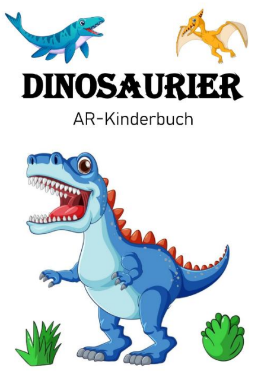
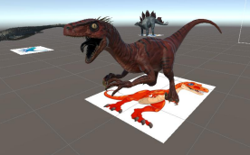
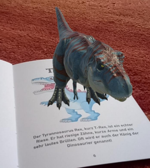
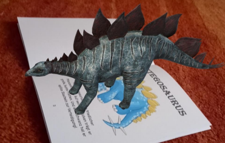

# IU-Project-AR-Kinderbuch

  

An interactive children's book about dinosaurs. A smartphone app recognizes the pictures in the book and places a 3D dinosaur on each of them, so children can look at it from all sides. Built with **Unity** and **Vuforia** as a project at IU International University of Applied Sciences (April 2025). The book itself was also designed, printed and bound.

## How it works

1. The book has five pages, each with a cartoon dinosaur and a short text.
2. Each picture is an **image target** (marker) in a Vuforia database.
3. When the camera sees a picture, the app shows the matching animated 3D model on top of it. When the picture leaves the camera view, the model disappears.
4. At the start, a short info box explains how to use the app.

The app runs on a PC (with a webcam) and on Android devices. The target group is children from 4 to 8 years, plus parents and caregivers. The markers are friendly cartoon drawings, and the 3D models are realistic but not frightening.

## Preview

A video showing the created app can be found here: https://github.com/JuleEngel/IU-Project-AR-Kinderbuch/releases/tag/v1

## Screenshots

| Raptor in the Unity editor | T-Rex on the book page | Stegosaurus on the book page |
|:---:|:---:|:---:|
|  |  |  |

## Built with

- Unity 2022.3.61f1 (3D project, built-in render pipeline)
- Vuforia Engine (image targets)
- Blender (adjusting materials and colors of the models)
- GIMP (preparing the marker images for Vuforia)
- Android Studio (checking the manifest and permissions, making the APK compatible)

## Limitations and ideas

- Recognition can fail in poor light, and very fast camera movement can make a model float for a moment.
- Android only. An iOS version would need a Mac and an Apple developer account.

Ideas for later versions:

- Dinosaur sounds that match the animations
- Reacting to speech, for example to a dinosaur's name
- A virtual companion figure that tells facts about each dinosaur

## Credits

### 3D models

| Model | Author | Source | License |
|---|---|---|---|
| T-Rex: Animated 3D Tyrannosaurus Rex Dinosaur Loop | LasquetiSpice | [Sketchfab](https://sketchfab.com/3d-models/animated-3d-tyrannosaurus-rex-dinosaur-loop-5339a88494084a98bd2bb1104a7f48f0) | see source page |
| Pteranodon: Animated Flying Pteradactal Dinosaur Loop | LasquetiSpice | [Sketchfab](https://sketchfab.com/3d-models/animated-flying-pteradactal-dinosaur-loop-09f6b1ff7bfd4a2d8d9c0b9827f2a708) | CC BY 4.0 |
| Mosasaurus: Mosasaurus 3D Model | DailyArt | [Sketchfab](https://sketchfab.com/3d-models/mosasaurus-4a1feecff6c7468b8c07ba0ad439e0e0) | see source page |
| Stegosaurus and Raptor: PBR Animated Dinosaurs | Ferocious Industries | [Unity Asset Store](https://assetstore.unity.com/packages/3d/characters/animals/pbr-animated-dinosaurs-256019) | Unity Asset Store EULA |

The models were adjusted in Blender (materials and colors). The 3D model files are not part of this repository.

### Marker images

Cartoon illustrations from Freepik:

| Dinosaur | Author |
|---|---|
| Mosasaurus | mikailain |
| Pteranodon | mimosastudio |
| Stegosaurus | brgfx |
| T-Rex | grfxrf |
| Raptor | brgfx |

### Tools and platforms

[Unity](https://unity.com/), [Vuforia](https://developer.vuforia.com/), [Blender](https://www.blender.org/), [GIMP](https://www.gimp.org/), [Android Studio](https://developer.android.com/studio)

## Author

Jule Engel
